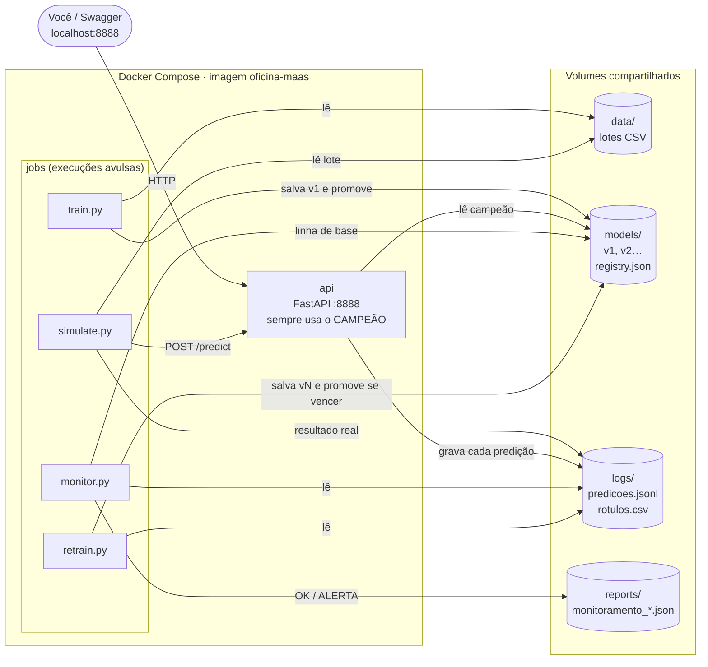
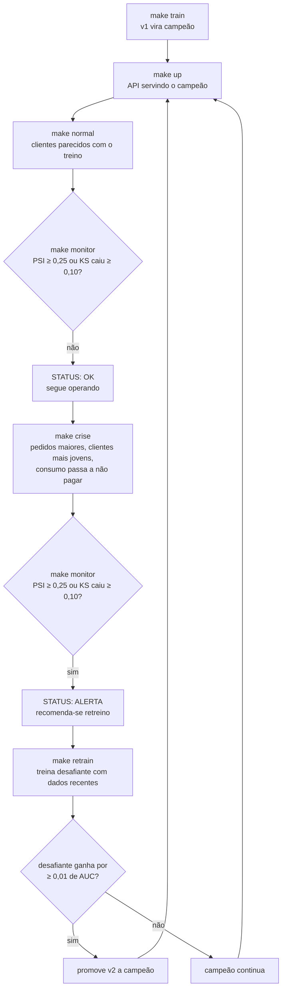
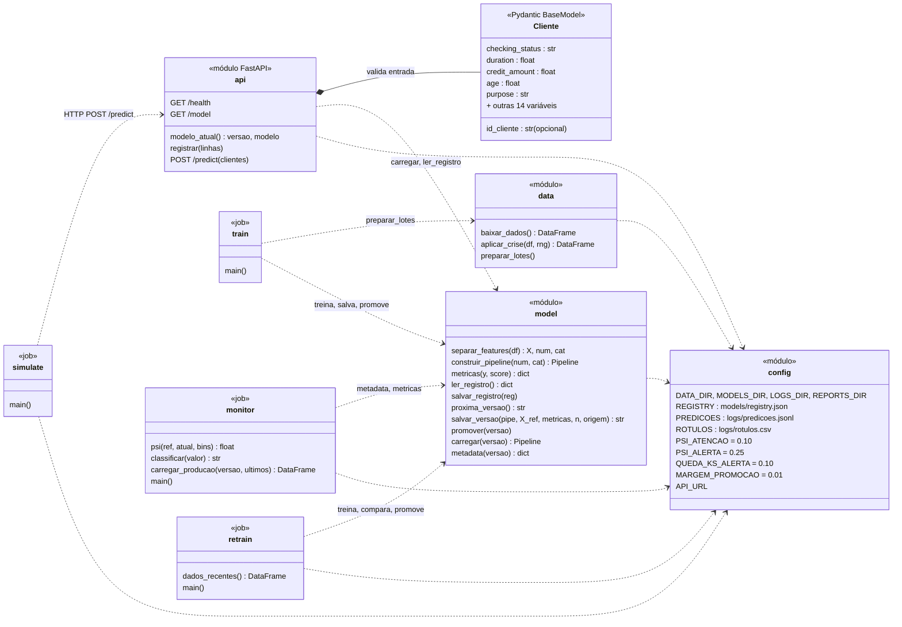
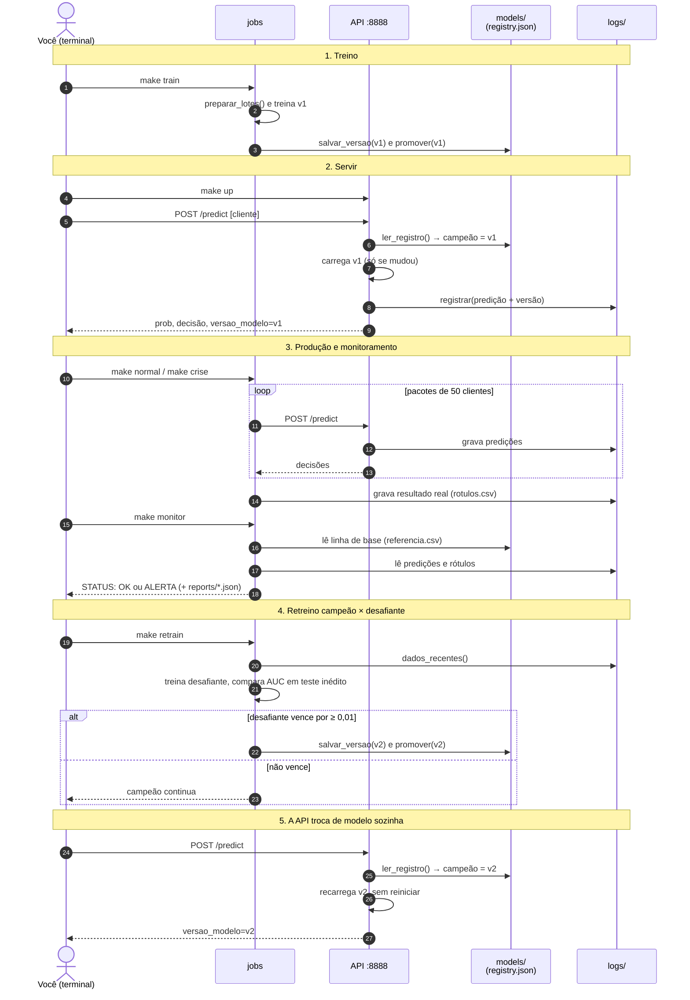

# Oficina: Model as a Service na prática

Um mini **Model as a Service** de ponta a ponta: treinamos um modelo de crédito, publicamos como API, monitoramos a produção, detectamos uma crise e retreinamos com a lógica **campeão × desafiante**.

> Você não precisa saber Python para acompanhar. Todos os comandos estão prontos abaixo. Quem programa pode abrir os arquivos em `src/`: cada função tem um comentário explicando o que faz.

## Requisitos

- **Docker** com Compose v2. Confira com `docker compose version`.
- **`make`** (opcional). Cada atalho tem o comando `docker compose` equivalente ao lado.

## Como rodar

```bash
# 0. Baixar o projeto
git clone https://github.com/prof-ronildo-unicatolica/oficina-maas.git
cd oficina-maas

# 1. Construir a imagem (5 a 10 min na primeira vez)
make build        # ou: docker compose build

# 2. Preparar os dados e treinar o modelo v1
make train        # ou: docker compose run --rm jobs python -m src.train

# 3. Subir a API
make up           # ou: docker compose up -d api
```

A API fica em **http://localhost:8888**, e a documentação interativa (Swagger) em **http://localhost:8888/docs**.

```bash
curl http://localhost:8888/health
# {"status":"ok","campeao":"v1"}
```

## O roteiro da oficina

| Passo | Atalho | Comando equivalente | O que acontece |
|---|---|---|---|
| 1 | `make train` | `docker compose run --rm jobs python -m src.train` | Treina o v1 e o promove a campeão |
| 2 | `make up` | `docker compose up -d api` | Sobe a API na porta 8888 |
| 3 | `make normal` | `docker compose run --rm jobs python -m src.simulate --lote normal` | Envia 200 clientes "normais" |
| 4 | `make monitor` | `docker compose run --rm jobs python -m src.monitor` | Mede o drift → **STATUS: OK** |
| 5 | `make crise` | `docker compose run --rm jobs python -m src.simulate --lote crise` | Envia 200 clientes durante uma crise |
| 6 | `make monitor` | `docker compose run --rm jobs python -m src.monitor` | Mede de novo → **STATUS: ALERTA** |
| 7 | `make retrain` | `docker compose run --rm jobs python -m src.retrain` | Desafiante vence, e o **v2** vira campeão |

Para acompanhar os logs da API: `make logs` (ou `docker compose logs -f api`).

## Parar e limpar

```bash
make down         # ou: docker compose down   → para os containers
make reset        # apaga lotes, modelos, logs e relatórios e para tudo (recomeça do zero)
```

## Arquitetura

Uma única imagem Docker (`oficina-maas`) é usada de dois jeitos: o serviço **`api`** fica sempre no ar, e o container **`jobs`** roda as tarefas avulsas. Os dois compartilham as pastas do projeto por volumes.



## Fluxo da aplicação



## Diagrama de classes

O código é organizado em módulos com funções (não há classes de verdade, exceto `Cliente`). O diagrama mostra cada módulo como uma "classe", com suas funções e as dependências entre eles.



## Diagrama de sequência

O ciclo completo de vida do modelo, do treino ao retreino.



## Estrutura do projeto

```text
oficina-maas/
├── src/
│   ├── config.py     # pastas, arquivos e limites (PSI, KS, margem)
│   ├── data.py       # carrega o dataset e cria os lotes normal e crise
│   ├── model.py      # pipeline, métricas e registro de versões
│   ├── train.py      # etapa 1: treina o v1
│   ├── api.py        # etapa 2: API FastAPI
│   ├── simulate.py   # etapa 3: simula clientes chamando a API
│   ├── monitor.py    # etapa 4: PSI, KS e AUC → OK / ALERTA
│   └── retrain.py    # etapa 5: campeão × desafiante
├── data/             # credit_g.csv (vem no projeto) + lotes gerados
├── models/           # v1/, v2/... e registry.json (gerado)
├── logs/             # predicoes.jsonl e rotulos.csv (gerado)
├── reports/          # relatórios de monitoramento (gerado)
├── Dockerfile
├── docker-compose.yml
├── Makefile
└── pyproject.toml    # configuração do Ruff
```

## Qualidade de código (Ruff)

O projeto usa o [Ruff](https://docs.astral.sh/ruff/) como linter e formatador. Ele roda em um container, sem instalar nada:

```bash
make lint         # verifica estilo, imports e erros comuns
make format       # corrige o que der automaticamente e formata
```

## Trocar a porta

Se a 8888 estiver ocupada:

```bash
cp .env.example .env    # e mude para API_PORT=8889
# ou, só desta vez:
API_PORT=8889 make up
```

Os jobs continuam funcionando, porque falam com a API pela rede interna do Docker.

## Dataset

German Credit Data (Statlog), Prof. Hans Hofmann, Universidade de Hamburgo, 1994. Fonte: [UCI Machine Learning Repository](https://archive.ics.uci.edu/dataset/144/statlog+german+credit+data), licença CC BY 4.0. Já vem em `data/credit_g.csv`, para funcionar sem internet.
